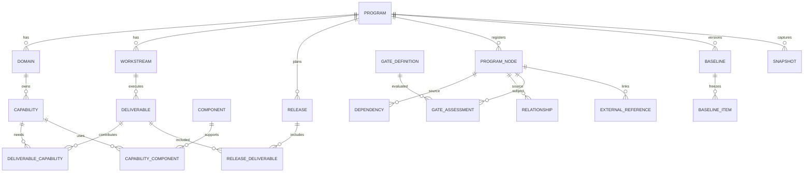

# Modelo relacional — ERD lógico

## Schemas propostos
`iam`, `portfolio`, `architecture`, `delivery`, `governance`, `evidence`, `integration`, `reporting`, `audit`.

## Decisões de modelagem
- `program_nodes` permite FK real para relações/dependências tipadas, evitando `type + UUID` solto.
- `deliverable_capabilities` é N:N e tem `contribution_type` (REQUIRED, OPTIONAL, SUPPORTING).
- `baseline_items` guarda dados congelados e hashes/versões, não referencia somente linha mutável.
- `snapshots` incluem `payload`, `formula_version`, `source_as_of`, hash e timestamp.
- `gate_assessments` guarda `gate_version`, `assessment_version`, evidências e aprovador.
- `external_references` tem UNIQUE `(connection_id, external_id, entity_type)`.
- `audit_events` append-only; edição/exclusão por política de retenção, não pelo usuário comum.

## Notas
SQL em `schema.sql` é **referência inicial**, não substitui migrations incrementais, testes de integridade e validação de políticas de acesso.
